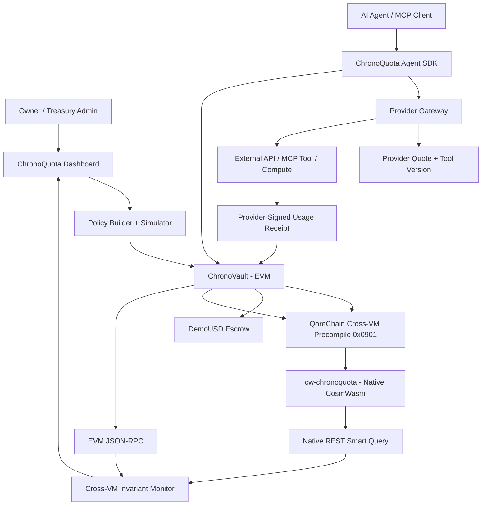

# ChronoQuota

## Cross-VM capability control, usage metering, and settlement for autonomous software

> **Working thesis:** An AI agent should be able to use paid APIs, MCP tools, and compute services autonomously without receiving unrestricted credentials or treasury access. ChronoQuota gives the agent a narrow, time-bound capability; lets providers verify and reserve that capability; and coordinates usage authorization with payment settlement across QoreChain EVM and QoreChain Native in one atomic transaction.

**Hackathon category:** QoreChain Build Before Q-Day — Advanced / Cross-VM  
**Network target:** QoreChain Diana testnet (`qorechain-diana`, EVM chain ID `9800`)  
**Project status:** Product and architecture specification; implementation must begin with the validation gates in this README.  
**Research snapshot:** 23 November 2026. Live network parameters can change; re-check them before each deployment.

---

## 1. Executive summary

ChronoQuota is not another AI agent, chatbot, wallet, or generic x402 payment gateway. It is an **authorization and settlement layer for software agents that consume paid services**.

A company may run a research agent that uses market-data APIs, a web-search MCP tool, document extraction, and GPU inference. The company wants the agent to work without asking for permission on every request, but it cannot give the agent an unrestricted API key or the treasury's primary private key.

The company therefore creates a capability such as:

- This agent may call `market.search` and `web.extract`.
- Only these provider identities and tool versions are allowed.
- The capability permits 10 units of usage in total.
- Each job may cost at most 0.50 DemoUSD.
- Total spending may not exceed 5.00 DemoUSD.
- The capability expires at a specified QoreChain block height.
- A job ID can be reserved and settled only once.
- The owner may revoke the capability.

The AI can propose which tool to use, but **AI output never decides whether a transaction is authorized**. A deterministic policy check and the on-chain contracts decide that.

ChronoQuota separates the system into two coordinated execution responsibilities:

| QoreChain EVM | QoreChain Native (CosmWasm) |
|---|---|
| Holds the demo payment escrow. | Maintains the canonical capability quota and reservation state. |
| Checks the owner's policy, quote, signatures, amount, nonce, and job state. | Checks capability status, expiry, allowed provider/tool identifiers, available quota, duplicate job IDs, and reservation state. |
| Pays a provider or releases a reservation. | Reserves, consumes, releases, or revokes usage capacity. |
| Emits EVM events and stores settlement identifiers. | Stores Native capability/job state and queryable execution records. |

A synchronous EVM-to-Native call through QoreChain's Cross-VM bridge coordinates the two sides. If Native refuses a reservation or settlement, the EVM transaction reverts. If EVM fails after the Native state update, the Native update must roll back with it. This atomicity must be proven on Diana testnet, not assumed from a local mock.

### One-sentence differentiator

**Where agent-wallet winners constrain what a key can sign, ChronoQuota coordinates a service capability, a usage reservation, a signed service receipt, and payment settlement across EVM and Native state—with the two on-chain state transitions committed or reverted together.**

---

## 2. The problem

### 2.1 The current unsafe choices

Developers integrating AI agents with paid services commonly face a bad trade-off:

1. **No autonomy:** A human approves every API call or transaction. This makes agents slow and expensive to operate.
2. **Excessive authority:** An agent receives a long-lived API key, a wallet private key, or a broad session key. A prompt injection, tool compromise, bug, or runaway loop can misuse the authority.
3. **Disconnected quotas:** One service provider tracks API usage in its own database, another tracks payments separately, and the treasury tracks spending in a third place. These records can disagree, be stale, or be controlled by a single party.
4. **Payment before authorization is fully checked:** A service can be paid even when the associated usage should have been denied, or a service can do work before there is a reliable payment/usage reservation.
5. **Weak auditability:** A wallet transaction may show a payment but not which agent, tool version, job, policy, usage receipt, and service result it was associated with.

### 2.2 The precise problem statement

> **How can an organization delegate narrowly scoped, time-bound, metered authority to autonomous agents so they can consume paid external services without exposing treasury credentials, exceeding a quota, reusing a job authorization, or creating inconsistent authorization and payment records across execution systems?**

### 2.3 Who experiences this problem?

**Primary customers**

- Developers and companies operating autonomous agents.
- Providers of paid APIs, MCP tools, data feeds, and compute services.
- Agent platforms that need tenant-level budgets, service allowlists, and an auditable usage trail.

**Initial user personas**

- **Agent owner / treasury administrator:** Creates capabilities, funds escrow, selects limits, and revokes access.
- **Agent runtime:** Discovers permitted tools, requests quotes, and asks for reservations. It never receives the owner's primary private key.
- **Service provider:** Publishes a priced API/MCP tool, checks an authorization reservation, performs the service, and submits a signed usage receipt.
- **Auditor / developer:** Inspects the EVM settlement and Native capability state and checks that their invariants match.

### 2.4 When blockchain is useful—and when it is not

A single company with one agent and one trusted API provider may be better served by a conventional database and billing service. ChronoQuota is aimed at **multi-party service ecosystems** where agent owners, agent runtimes, and providers need to verify shared authorization and settlement state without depending on one provider's private database.

QoreChain Native is intended to expose a shared, queryable Native capability state to Native/Cosmos-aware services, while EVM handles EVM-compatible escrow and settlement. The Cross-VM call keeps the state transition coordinated. This must provide a concrete advantage in the product; do not add a Native call merely to satisfy a checklist.

---

## 3. Product definition

### 3.1 What ChronoQuota is

ChronoQuota is a **capability control plane plus metered settlement protocol**. The dashboard is the user interface; the agent/MCP integration is the client interface; the contracts are the deterministic enforcement layer.

It is composed of:

1. **Capability Studio:** The owner defines service permissions, usage limits, price limits, expiry, and revocation rules.
2. **Policy Preview / Simulator:** Shows what would be allowed or denied, why, and the maximum financial exposure before the owner signs.
3. **EVM Escrow Vault:** Holds demo payment tokens and enforces financial limits.
4. **Native Capability Engine:** Maintains the canonical capability, quota, and job reservation state in CosmWasm.
5. **Agent SDK / MCP Server:** Lets an agent discover allowed tools, request quotes, reserve usage, and submit execution requests.
6. **Provider Gateway:** Exposes paid tools, returns quotes, checks confirmed reservations, performs work, and signs a result/usage receipt.
7. **Cross-VM Invariant Monitor:** Reads EVM and Native state and shows whether usage, reservations, payment, and receipts agree.

### 3.2 What ChronoQuota is not

- It is not a general-purpose AI agent or LLM platform.
- It is not a new blockchain, bridge, or rollup.
- It is not a custodial wallet that stores user seed phrases.
- It is not a generic API marketplace for the MVP.
- It does not claim that a provider's signed receipt proves the quality or truth of off-chain computation. It proves that the provider submitted a signed statement; stronger proof requires additional verification such as TEE attestations, reproducible execution, or a dispute mechanism.
- It does not claim that a blockchain rollback can undo an external API call. A provider must wait for a confirmed reservation before doing billable work.

### 3.3 Product promise

**Autonomy within a capability, not autonomy over the treasury.**

The owner authorizes the capability once. The agent can operate without repetitive human approvals while the deterministic policy remains in force. If the request is outside scope, expired, over budget, duplicated, revoked, or unsupported, the system denies it.

---

## 4. How it works — simple end-to-end example

A company funds its ChronoQuota vault with 5.00 DemoUSD and creates a capability for its `ResearchAgent`:

- Allowed provider: `DataProvider-A`.
- Allowed tool: `market.search`.
- Allowed tool version: a fixed tool-schema/version hash.
- Total usage: 10 units.
- Per-job maximum: 1 unit.
- Maximum price per job: 0.50 DemoUSD.
- Maximum total spend: 5.00 DemoUSD.
- Expiry: a specified QoreChain block height.

The agent asks for market data. The provider returns a quote. ChronoQuota checks the capability and reserves the required units and funds. Only after the reservation transaction is confirmed does the provider perform the work. The provider then signs a receipt containing the job ID, tool version, input commitment, output digest, usage amount, and final price. ChronoQuota verifies the receipt, finalizes the Native usage state, and releases the payment from escrow.

If the agent tries to call a disallowed tool or exceed the quota, the Native capability engine rejects the operation and the EVM transaction reverts. If EVM settlement fails after the Native update, the Native update must also revert.

---

## 5. Key product capabilities

### 5.1 Capability Passport

Every authorization has a unique, versioned `capabilityId`. Its policy is bound to:

- Owner / tenant.
- Agent identity (EVM and/or Native address binding).
- Permitted provider IDs.
- Permitted tool IDs and tool-version/schema hashes.
- Permitted actions or action-schema hashes.
- Maximum usage units per job.
- Maximum total usage units.
- Maximum price per job.
- Maximum total spend.
- Optional usage window and maximum parallel jobs.
- Valid-from and expiry block heights.
- Policy version and revocation state.

The capability is not a private key. It is a constrained authorization record.

### 5.2 Policy compiler with human approval

The user may describe a policy in plain English, for example:

> Let the research agent use DataProvider-A's market search tool up to 10 times. Each request must cost no more than 0.50 DemoUSD. Stop at block height H.

An LLM may convert this into a proposed structured policy. The interface must display the normalized policy and financial exposure. The owner explicitly reviews and signs it. The LLM is never trusted to enforce the policy and cannot silently broaden permissions.

MVP: A form that produces a validated JSON policy is sufficient. Natural-language compilation is a stretch feature.

### 5.3 Preflight simulation and explainable denials

Before signing a capability or submitting a job, show:

- Whether the policy would allow the request.
- Which exact rule allowed or denied it.
- Remaining units and remaining spend.
- Maximum possible exposure.
- Whether the request uses a new or already-seen job ID.
- Whether the policy, tool version, or quote has changed.

This is a UX feature. The final decision remains enforced by contracts.

### 5.4 Reserve-before-work execution

The provider must not start billable work just because an agent has read a quota value from a REST endpoint. Two agents could race against the same remaining quota.

Instead:

1. The provider returns a quote with a unique `quoteId`, provider ID, tool ID/version hash, maximum charge, and expiry.
2. The agent submits a reservation request.
3. EVM verifies the owner-approved policy and locks the maximum charge in escrow.
4. EVM calls Native synchronously to reserve units against the capability and job ID.
5. Both state changes commit or both revert.
6. The provider verifies the confirmed reservation and only then performs the job.

### 5.5 Signed service receipt

After performing the job, the provider submits a receipt containing at least:

- `capabilityId`
- `jobId`
- `quoteId`
- `providerId`
- `toolId` and `toolVersionHash`
- `requestHash` or privacy-preserving input commitment
- `outputHash`
- `unitsConsumed`
- `finalPrice`
- `providerNonce`
- `issuedAt` / expiry information

The receipt signature must cover a domain-separated digest containing the chain ID and ChronoQuota contract address. This prevents cross-chain, cross-contract, and cross-job replay.

MVP may use a well-defined EVM signature scheme for provider receipts. A post-quantum ML-DSA-87 provider-receipt verification path is a high-value extension only after the current QoreChain `pqcVerify` ABI and gas requirements are confirmed with a working test. Do not claim that ordinary EVM transactions themselves carry an ML-DSA signature: QoreChain uses a registered PQC key and an EVM authorization window to admit ordinary EVM transactions.

### 5.6 Cross-VM invariant monitor

The dashboard displays both lanes side by side:

- EVM capability/escrow state.
- Native capability/quota/reservation state.
- Job state and receipt digest.
- Paid amount and released amount.
- Last successful Cross-VM transaction.
- Whether the expected invariants currently match.

The monitor reads Native state through the Native REST smart-query endpoint and EVM state through JSON-RPC. Do not try to use `STATICCALL` through the Cross-VM bridge to read a mutating Native contract. Native query and EVM query are separate read paths.

### 5.7 Emergency revocation and provider isolation

The owner can revoke a capability. New reservations must be denied. Provider IDs and tool-version hashes are pinned into the capability so that an agent cannot swap a permitted tool for an unreviewed replacement.

Pending reservations need explicit lifecycle rules. The MVP should use short reservation expiries and support deterministic cancellation/timeout. Do not claim that revocation can undo work a provider has already performed.

---

## 6. What is genuinely new compared with existing agent-payment winners?

This project is inspired by successful systems, but it must not copy their code or simply repackage their features.

| Existing winner / pattern | What it already demonstrates | ChronoQuota's intended extension |
|---|---|---|
| **AgentFabric** — Cronos x402 PayTech Hackathon, 1st place | Scoped session keys, smart-account workflows, x402 API proxies, MCP integration, and bounded agent execution on Cronos EVM. | Make the capability quota and reservation lifecycle a Native state machine; atomically coordinate Native usage reservation/finalization with EVM escrow/payment; provide a dual-VM invariant monitor. |
| **Harness** — ETHOnline 2026, Ledger AI Agents x Ledger 1st | Isolated agent containers, identities, and owner-defined spending limits. | Focus on service-level capabilities, reservations, usage receipts, and two-lane settlement rather than container isolation. |
| **Kagi Wallet** — ETHGlobal Tokyo 2026, Intercepta 1st | Threshold wallet authority and capped/expiring delegated agent keys. | Complement delegated keys with service/tool-specific quotas and provider-side reservations; do not claim to replace hardware threshold signing. |
| **Signel** — ETHGlobal Cannes 2026, Ledger AI Agents x Ledger 1st | On-chain contract/function/amount restrictions for delegated agents. | Add provider identity, tool-version binding, usage metering, reservation/finalization, and Native/EVM atomic state coordination. |
| **allowance.eth** — ETHGlobal New York 2026, ENS award | Human-readable policies anchored to agent identity and enforced by contract rules. | Add a cross-runtime capability state machine and service-provider execution receipts. |
| **AgentGate** — ETHGlobal Cannes 2026, World AgentKit 1st | Provider-facing pay-per-call API gateway and x402 service access. | Add organization-owned capabilities, Native-side quotas, reservation before work, and atomic payment/usage finalization. |

### Our defensible thesis

The novelty is **not** “AI agent + API + crypto payment.” Those pieces already exist.

The intended differentiator is the **capability lifecycle across two QoreChain execution environments**:

1. EVM holds and accounts for payment.
2. Native holds the canonical service capability and quota lifecycle.
3. Native reservation/consumption and EVM financial state are committed atomically.
4. Provider receipts bind service usage to the capability and job.
5. The dashboard independently reads both lanes to demonstrate the invariant.

This is a technical hypothesis to prove, not a claim that no other project anywhere has ever built a similar system.

---

## 7. QoreChain architecture and current constraints

### 7.1 Network target

Use QoreChain Diana testnet only for this project:

| Item | Value |
|---|---|
| Cosmos chain ID | `qorechain-diana` |
| EVM chain ID | `9800` |
| EVM JSON-RPC | `https://evm-testnet.qore.host` |
| Native REST | `https://api-testnet.qore.host` |
| Consensus RPC | `https://rpc-testnet.qore.host` |
| Cross-VM bridge precompile | `0x0000000000000000000000000000000000000901` |
| Native target VM identifier | `1` |

The official governance-proposal guide says Diana has run v3.2.9 since 20 November 2026. Some Cross-VM reference pages are labelled v3.2.8 and may not yet reflect all later network changes. Treat documentation version labels as a warning to verify live parameters, not as permission to assume a state.

Mainnet Cross-VM is not available as the target for this hackathon implementation. The synchronous bridge is enabled on testnet, while the official Cross-VM documentation reports mainnet calls paused by the circuit breaker.

### 7.2 Synchronous EVM-to-Native call

The documented bridge precompile interface is:

```solidity
executeCrossVMCall(uint8 targetVM, string targetContract, bytes payload)
```

Expected call structure:

- `targetVM = 1` for QoreChain Native / CosmWasm.
- `targetContract` is the approved Native contract's `qor1...` Bech32 address.
- `payload` is the Native contract's UTF-8 JSON execute message.
- The precompile address is `0x0000000000000000000000000000000000000901`.

The selector documented for this function is `0x3c11078c`. Confirm the ABI and return-data format against the latest docs, starter code, and a live test before finalizing the adapter.

**Critical safety check:** A precompile address that is inactive may return success with empty data. A low-level call must therefore require both `ok == true` and a non-empty, correctly decoded response. A non-empty response alone is not proof that the correct Native state changed; query the Native contract after the transaction.

### 7.3 Atomicity requirement

The Cross-VM category requires a working EVM-to-Native call to an approved Native contract and an atomicity demonstration on testnet.

The minimum evidence must show:

1. EVM + Native success: both expected state changes commit.
2. Native-side failure: Native refuses; the EVM transaction and its state changes revert.
3. EVM-side failure after Native mutation: Native state is also rolled back.
4. Unapproved target: bridge refuses the call.
5. Duplicate/replayed job: the second reservation/finalization is denied.

A mocked bridge test is useful for fast unit tests but does not replace a real Diana testnet transaction.

### 7.4 Native contract allowlist and governance

The bridge can call only Native contracts in the governance-controlled `bridge_allowed_targets` allowlist, with code pins. A code address, code ID, or contract from an old report must not be assumed to remain approved.

The official contract-governance guide, checked against Diana on 22 November 2026, explains how a builder can:

1. Compile a CosmWasm contract reproducibly.
2. Submit a governance proposal to store the code and optionally instantiate it.
3. Submit a governance proposal to add the instantiated contract to the Cross-VM allowlist, pinned to its code ID and code-history length.
4. Verify the result through live REST endpoints.

The guide reports a regular proposal minimum deposit of 10 QOR and a 4-hour voting period after the required deposit is reached; an expedited proposal requires 50 QOR and a higher yes threshold. Re-check live governance parameters. **Governance approval is not guaranteed.**

Preferred route: create a small, purpose-built `cw-chronoquota` contract and pursue governance approval early. The Native contract should be immutable after deployment (no admin/migration path unless a narrowly justified governance-controlled process is documented).

Fallback route: use an already approved Native contract only after checking its live address, code pin, execute schema, query schema, and actual semantics. The currently documented `qday-receipts` contract is a receipt book, not a quota engine. A receipt-only fallback may prove Cross-VM integration, but it must not be represented as Native-enforced quota logic.

### 7.5 Known existing Native contract: qday-receipts

The official Workshop 3 documentation identifies `qday-receipts` as a reviewed, allowlisted Diana testnet contract:

```text
qor1xjayq5ev55tkzpml9klxwyshr7gdrha0nurha9jhm0f0gdckksgs3gltw8
```

The workshop documents these operations:

- `{"record":{"note":"..."}}` — append receipt data.
- `{"fail":{}}` — intentionally fail, useful for demonstrating rollback.
- Queries such as `count`, `receipt`, and `latest`.
- Notes are limited to 140 characters and have input restrictions.

It records a receipt ID, sender, note, and block height. It does **not** enforce ChronoQuota's custom capability schema, usage-unit accounting, per-tool permissions, pending reservations, or provider settlement.

### 7.6 WDT CW20: treat as a candidate, not a proven policy engine

Prior research identified a WDT CW20 contract at:

```text
qor14hj2tavq8fpesdwxxcu44rty3hh90vhujrvcmstl4zr3txmfvw9s93uuqt
```

This address is a **candidate from the research notes and must be verified against the live `bridge_allowed_targets` list and code pin before use**. Do not hard-code it based only on this README.

The prior research proposed using CW20 `increase_allowance` / `decrease_allowance` as a Native quota. There is a critical semantic warning: upstream CW20 describes `DecreaseAllowance` as robust; decreasing by an amount greater than or equal to the current allowance clears/deletes the allowance instead of necessarily reverting. Also, an expiry stored on an allowance is not automatically a reliable rejection mechanism for every `decrease_allowance` call. Do not assume that calling `decrease_allowance` against an expired allowance will produce the required `NoAllowance` failure.

Before using WDT for any enforcement claim, inspect the exact deployed code ID/source and run tests against the contract on Diana for:

- `increase_allowance` with expiry;
- query behaviour before and after expiry;
- `decrease_allowance` before and after expiry;
- explicit `expires` argument behaviour;
- exact allowance exhaustion;
- over-decrease behaviour;
- revoked or missing allowance behaviour.

**Preferred architecture:** use a dedicated `cw-chronoquota` contract with explicit expiry checks and checked quota arithmetic. Do not rely on a generic CW20 token allowance to implement semantics it was not designed to guarantee.

### 7.7 EVM authorization window and PQC

QoreChain's EVM account admission requires a registered ML-DSA-87 key and a live EVM authorization window opened through a hybrid-signed Native-lane message. The ordinary EVM transaction itself remains a standard EVM transaction signed with secp256k1; do not say that each EVM transaction carries an ML-DSA-87 signature.

The window limits blocks, transaction count, QOR value/fees and optionally allowed targets. Follow the current official EVM authorization-window reference and Workshop 3 setup rather than copying old command flags blindly. The account's EVM nonce and Native sequence are related; open the window before reading/signing the EVM nonce.

QoreChain's testnet documents these precompiles as active at the time of the research snapshot:

- `0x...0901` — Cross-VM bridge.
- `0x...0A01` — PQC signature verification.
- `0x...0A02` — PQC key status.
- `0x...0C01` — PRISM consensus parameters.

The two AI precompiles `0x...0B01` and `0x...0B02` are documented as inactive. Every precompile must be checked against the live active-precompile parameter. An inactive precompile can return empty data without reverting.

### 7.8 Native reads and observability

The EVM bridge is for execution, not a Solidity `STATICCALL` query interface for Native state. Read Native smart-query state through the Native REST API. The browser may need a small server-side read-only proxy because the public REST endpoint may not provide browser CORS headers.

Native events are not returned as ordinary EVM logs. Emit EVM events for EVM-facing observability and query Native state separately to verify the cross-VM result.

---

## 8. Target architecture

### 8.1 High-level system diagram



### 8.2 EVM contracts

**`ChronoFactory.sol` (optional for MVP)**

- Deploys or registers owner-specific vault instances if separation is required.
- Must not be added merely for architecture decoration. A single `ChronoVault` with owner-separated state may be simpler for the first demo.

**`ChronoVault.sol` (core)**

Responsibilities:

- Maintain owner permissions and capability metadata needed for EVM-side checks.
- Hold DemoUSD escrow.
- Store job state and unique job IDs.
- Validate quotes, price caps, owner approval, provider identity, tool/version hash, nonces, and expiry.
- Call the Native contract through the Cross-VM precompile.
- Reserve funds, settle provider payments, and release unused reservations.
- Emit clear EVM events for capability and job transitions.
- Revert if the bridge is inactive, refuses the call, returns unexpected data, or Native state transition fails.

**`CrossVMAdapter.sol` / library**

- Encapsulate bridge address, target VM, approved Native address, JSON encoding, low-level call handling, response parsing, and revert reasons.
- Reject empty response data.
- Keep all dynamic payload construction safe and deterministic.
- Do not silently fall back to mock/local success when the bridge fails.

**`DemoUSD.sol`**

- A local/testnet ERC-20 mock token with a fixed 6-decimal representation for the demonstration.
- Do not label a locally deployed mock as USDC or a real stablecoin.
- Do not hard-code an undocumented fUSD token address.

### 8.3 Native CosmWasm contract: `cw-chronoquota`

The preferred Native contract should be a small deterministic state machine, not a general workflow engine.

**Core state**

- Authorized EVM caller(s), based on the Native caller identity observed by the bridge.
- Capability records keyed by `(EVM caller namespace, capabilityId)`.
- Capability policy hashes and allowed provider/tool/version hashes.
- Total units, used units, reserved units, per-job maximum, valid-from height, expiry height, and active/revoked status.
- Job records keyed by a unique `jobId` with states such as `Reserved`, `Settled`, `Cancelled`, and `Expired`.
- Provider receipt digest and final usage data after settlement.

**Core execute operations (conceptual; define exact Rust schema during implementation)**

- `register_capability`
- `reserve_job`
- `settle_job`
- `cancel_job`
- `revoke_capability`

**Core query operations**

- `capability`
- `job`
- `usage_summary`
- `config`

**Native enforcement requirements**

- Check the actual `env.block.height` / `env.block.time` where relevant.
- Use checked arithmetic; never silently saturate a capability quota to zero.
- Reject expired, revoked, unknown, or not-yet-active capabilities.
- Verify provider/tool/version/action hashes are in the policy.
- Reject duplicate `jobId` / nonce use.
- Prevent reservations beyond available quota or maximum parallel reservations.
- Do not allow a job to be settled twice or cancelled after settlement.
- Restrict execute calls to approved EVM contract caller identities.
- Keep the contract deterministic and avoid floating-point values.
- Prefer no admin after deployment; if governance migration is necessary, document the trust implications and code-pin effects.

**Important:** The EVM bridge passes the EVM contract's derived Native `qor1...` identity to the Native contract, not the originating browser EOA. Discover and test the exact sender derivation on Diana. Use this as an isolation boundary where appropriate.

### 8.4 Agent SDK and MCP server

Expose a small set of tools:

- `list_allowed_tools` — list tools allowed by the current capability.
- `get_capability_status` — report remaining quota, expiry and spend state.
- `request_quote` — request price and version information from a provider.
- `reserve_job` — submit a reservation to ChronoQuota.
- `get_job_status` — check reservation/execution/settlement state.
- `submit_result_receipt` — relay the provider-signed receipt for finalization.

MCP is an integration interface, not an authorization authority. The MCP server must not invent permissions, sign as the owner, or bypass the contracts.

### 8.5 Provider Gateway

For the hackathon, one local demo provider is enough. It should:

- Register a provider ID and fixed tool-version hash.
- Return a signed quote with an expiry.
- Verify a reservation is confirmed before doing billable work.
- Execute a deterministic demo tool (for example, a simulated market-data query).
- Generate a signed usage receipt bound to the reservation.
- Submit the receipt to ChronoVault for settlement.

An x402 adapter may be added later for HTTP 402-compatible providers. Do not make x402 the core novelty; AgentFabric and other winners already demonstrate x402 API access and scoped agent payments.

---

## 9. Cross-VM transaction lifecycle

### 9.1 Create a capability

1. Owner selects services, tools, limits, and expiry in the dashboard.
2. Frontend serializes a versioned policy and displays it for owner approval.
3. Owner deposits DemoUSD into the EVM vault.
4. Owner signs/authorizes the capability according to QoreChain account requirements.
5. EVM validates the policy and calls Native `register_capability` through `0x0901`.
6. EVM stores the capability and Native stores the capability state in the same transaction.
7. If Native registration fails, the EVM capability/deposit changes revert.

### 9.2 Quote and reserve

1. Agent requests an allowed MCP/API service.
2. Provider returns a quote containing provider ID, tool ID, tool-version hash, price, usage units, quote ID, and expiry.
3. Agent submits a `reserve_job` request to ChronoVault.
4. EVM validates owner policy, capability status, quote, maximum price, available escrow, per-call limits, job uniqueness, and EVM nonce.
5. EVM calls Native `reserve_job` with the capability ID, job ID, provider/tool hashes, requested units, and reservation expiry.
6. Native checks active status, expiry, scope, available quota, duplicate job ID, and reservation limits; it records the reservation.
7. EVM locks the maximum charge in escrow and records the job as `Reserved`.
8. The transaction commits both state changes or neither.
9. The provider waits for confirmed reservation before performing work.

### 9.3 Execute and settle

1. Provider performs the external job.
2. Provider signs a receipt bound to the capability, job, quote, tool version, result digest, measured units, price, nonce, and deadline.
3. Provider submits the receipt to ChronoVault.
4. EVM verifies the provider signature, job state, amount, nonce, expiry, and policy version. If ML-DSA-87 verification is used, first validate the current QoreChain precompile ABI and key format.
5. EVM calls Native `settle_job`, passing the verified usage and receipt digest.
6. Native transitions the reservation into settled usage, updates counters, and stores the receipt digest.
7. EVM releases the provider payment and returns any unused reserved amount to the owner's available escrow.
8. Both sides commit or both revert.

### 9.4 Cancellation / timeout

- A provider may explicitly fail a job; a reservation can then be cancelled under the policy.
- A reservation can expire after a defined block-height deadline.
- Cancellation must update Native reservation state and EVM escrow state atomically.
- A timeout must not silently erase a job that has already been settled.
- Do not promise refunds for work already completed outside the chain. A dispute/refund policy is a later product feature.

### 9.5 Revocation

- Owner revokes a capability.
- EVM validates owner authorization.
- EVM calls Native `revoke_capability` synchronously.
- New reservations are rejected after the transaction commits.
- Existing reservations follow an explicit policy: either they may settle only until their short reservation expiry, or the owner must cancel them. The MVP must select one rule and test it.

---

## 10. Core data model

Use integers for all amounts and units. Never use floating-point values for on-chain prices or quota.

### 10.1 Capability policy (illustrative JSON)

```json
{
  "schemaVersion": 1,
  "capabilityId": "0x<32-byte-id>",
  "ownerEvm": "0x<owner-address>",
  "agentEvm": "0x<agent-address>",
  "agentNative": "qor1<agent-address>",
  "allowedServices": [
    {
      "providerId": "data-provider-a",
      "toolId": "market.search",
      "toolVersionHash": "0x<32-byte-hash>",
      "actionHash": "0x<32-byte-hash>"
    }
  ],
  "maxUnitsPerJob": 1,
  "totalUnits": 10,
  "maxParallelJobs": 1,
  "maxPricePerJob": "500000",
  "maxTotalSpend": "5000000",
  "token": "0x<DemoUSD-address>",
  "validFromHeight": 0,
  "expiryHeight": 0,
  "policyVersion": 1
}
```

The values above are illustrative. `DemoUSD` uses six decimals in the demo. Native and EVM schemas must agree on integer widths and canonical hash encoding.

### 10.2 Quote

A quote should be domain-bound and include:

- `quoteId`
- `providerId`
- `toolId`
- `toolVersionHash`
- `units`
- `maxCharge`
- `currency/token`
- `quoteExpiryHeight`
- `providerNonce`

### 10.3 Job receipt

The receipt digest should cover at least:

- chain ID;
- ChronoVault contract address;
- capability ID and policy version;
- job ID and quote ID;
- provider ID and provider key ID;
- tool ID and tool-version hash;
- request/input commitment;
- output/result digest;
- usage units and final charge;
- provider nonce and deadline.

Do not put private prompts, customer data, raw API credentials, or sensitive computation inputs directly on-chain. Store only commitments/hashes where required.

---

## 11. Security model and threat analysis

### 11.1 Threats to address

| Threat | Required mitigation |
|---|---|
| Prompt injection persuades agent to exceed its authority | Agent has no owner key; deterministic contract policy controls the capability. |
| Agent key compromise | Narrow tool/provider/amount/usage/expiry scope; owner revocation; short reservation windows. |
| Tool/provider substitution | Bind provider ID and tool-version hash into the capability and receipt. |
| Replayed quote or receipt | Unique job IDs, monotonic nonces, chain/contract domain separation, state-machine checks. |
| Concurrent calls race for the last quota unit | Native atomic reservation and checked arithmetic; provider waits for confirmed reservation. |
| Provider performs work without payment reservation | Provider performs billable work only after confirmed reservation. |
| Provider claims more usage than reserved | EVM and Native check actual units and maximum charge against reservation. |
| Native call fails | EVM transaction reverts; payment is not released. |
| EVM fails after Native mutation | Native state must roll back with the EVM transaction; prove on Diana. |
| Bridge is inactive or target is not allowlisted | Check live params and circuit breaker; reject empty bridge response. |
| Malformed JSON / payload injection | Use a proper JSON serializer or fixed-size hex fields; never string-concatenate untrusted text into JSON. |
| Admin changes Native code after approval | Prefer immutable/no-admin contract and code pin; document governance assumptions. |
| LLM generates an unsafe policy | LLM output is only a proposal; schema validation + human approval + deterministic enforcement. |
| False provider receipt | Receipt proves provider attestation, not truth; later integrate TEE/reproducibility/disputes if required. |

### 11.2 Critical engineering invariants

1. `availableUnits + reservedUnits + consumedUnits == totalUnits` for every capability, subject to the exact contract state model.
2. `availableEscrow + reservedEscrow + paidOut + refunded == totalDeposited`.
3. Every `jobId` is unique within the capability and cannot be settled more than once.
4. `actualUnits <= reservedUnits` and `actualCharge <= reservedMaxCharge`.
5. No reservation can be created for revoked, expired, not-yet-active, or out-of-scope capabilities.
6. EVM job state and Native job state must agree after a successful transaction.
7. If either VM rejects a synchronous Cross-VM operation, no partial on-chain state is retained.
8. AI output is never an authority source.
9. External side effects only start after a confirmed on-chain reservation.
10. No secrets or private user data are stored in public chain state.

### 11.3 What the provider receipt does not prove

A provider-signed receipt is an accountable statement by the provider. It is not automatically proof that the API returned correct data, that a GPU performed the claimed computation, or that a model's answer was valid. A future release could add:

- TEE/remote-attestation evidence;
- reproducible execution or task-specific verifiers;
- a dispute window and challenge protocol;
- independent provider reputation;
- proof-of-compute or ZK verification where practical.

Do not attempt all of these in the hackathon MVP.

---

## 12. MVP scope

### 12.1 The minimum compelling demonstration

Build one end-to-end scenario:

- One owner.
- One agent identity.
- One provider gateway.
- Two demo tools with different tool-version hashes.
- One capability with a small quota, price cap, and block-height expiry.
- DemoUSD escrow on EVM.
- A working Native capability contract or an explicitly labelled lower-fidelity fallback.
- One reservation, one provider execution, one signed receipt, and one settlement.
- A successful Cross-VM transaction.
- A Native-side rejection with EVM rollback.
- An EVM-side revert after Native mutation with Native rollback.
- A duplicate job / replay attempt rejected.
- A dashboard showing the EVM and Native states side by side.

### 12.2 The demo script

**Scene 1 — Grant a capability**

The owner authorizes `ResearchAgent` to use `market.search` for 3 calls, no more than 0.50 DemoUSD per call, expiring at a shown block height. The owner deposits 1.50 DemoUSD.

**Scene 2 — Successful reserve**

The agent requests the tool. The provider returns a quote. The agent reserves one unit. Show EVM escrow reserved and Native quota reserved in the same confirmed transaction.

**Scene 3 — Provider execution and settlement**

The provider performs a deterministic demo query and signs a receipt. The owner sees the output digest, tool version, usage and charge. The provider is paid; Native usage becomes consumed.

**Scene 4 — Out-of-scope attempt**

The agent tries `gpu.inference` or an unapproved tool version. The policy rejects it. No EVM payment or Native quota change occurs.

**Scene 5 — Native-side failure**

Use a test-only Native failure branch or invalid capability to force Native refusal. Show the EVM transaction reverting and escrow remaining unchanged.

**Scene 6 — EVM-side failure after Native update**

Use a test-only harness or a controlled post-bridge EVM revert after Native state mutation. Show Native reservation/quota and receipt state also unchanged. Do not include a production-callable arbitrary `forceRevert` flag in deployed code; use a separate test contract or test harness.

**Scene 7 — Replay / concurrency**

Attempt the same job ID twice, or submit two simultaneous requests for the final available unit. Only one can reserve successfully.

### 12.3 Out of scope for the first build

- Full open provider marketplace.
- Multi-chain payments.
- Real USDC or mainnet treasury handling.
- Multi-provider arbitration and slashing.
- Full x402 facilitator compatibility.
- AI-generated smart contracts.
- TEE, ZK, or verifiable compute proofs.
- Multi-agent delegation trees.
- Production-grade accounting, invoicing, and tax compliance.

---

## 13. Optional “wow” features — prioritize only after the Cross-VM proof works

### Priority A — Policy Dry-Run / Blast-Radius Simulator

Let an owner simulate a sequence of agent actions against a proposed policy. Show which requests pass, which fail, the exact rule, remaining usage, maximum charge, and worst-case exposure. This is highly visible in the demo and does not require another on-chain protocol.

### Priority B — Capability Passport / Portable Policy

A stable capability ID and machine-readable policy that an agent runtime and multiple service providers can inspect. It should bind tool versions and action schemas. Do not claim cross-chain portability; the initial passport is QoreChain-specific.

### Priority C — Post-Quantum Provider Receipts

Provider receipts signed with ML-DSA-87 and verified through QoreChain's active PQC verification precompile, provided the exact ABI, registration/key format, signature bytes, and gas cost are validated. Use QoreChain's maintained `@qorechain/pqc` library and official standards; do not create a custom PQC variant.

### Priority D — Multi-Agent Delegation with Non-Expansion

An owner can grant a parent agent a capability, and the parent may delegate a smaller subset to a child agent. A child capability must never exceed the parent's allowed tools, units, price caps, or expiry. This is a stretch feature because it adds state and authorization complexity.

### Priority E — Risk Circuit Breaker

A deterministic circuit breaker can pause new reservations when the provider produces repeated invalid receipts, the quota invariant monitor detects a mismatch, or a defined usage anomaly threshold is crossed. AI can flag unusual behaviour, but it cannot unilaterally rewrite policy or transfer funds.

### Priority F — x402 Adapter

Add an x402-compatible provider adapter after the core protocol works. ChronoQuota's differentiator remains the Cross-VM capability and reservation state, not HTTP 402 itself.

---

## 14. Recommended technical stack

Use the simplest stack that proves the protocol. Do not introduce infrastructure without a concrete use case.

| Layer | Recommendation | Notes |
|---|---|---|
| EVM contracts | Solidity `^0.8.24`, Foundry | Follow the QoreChain workshop and current compiler compatibility. |
| Native contract | Rust + CosmWasm | Use the version/toolchain demonstrated by the current QoreChain Native docs and optimizer. |
| Cross-VM adapter | Solidity library using `0x0901` | Centralize payload encoding and empty-return/error handling. |
| Frontend | Next.js + TypeScript + Tailwind | Dashboard, capability editor, simulation, dual-state view. |
| EVM client | viem / wagmi or QoreChain's current documented integration | Check current QoreChain compatibility before pinning versions. |
| Agent integration | TypeScript + official MCP SDK | Expose only the ChronoQuota tools. |
| Provider demo | TypeScript / Node.js | One local paid-tool simulator and receipt signer. |
| PQC | `@qorechain/pqc` and QoreChain precompile only after ABI validation | Use NIST-standard implementations; do not invent cryptography. |
| Read proxy | Next.js route or minimal Node API | Needed if browser CORS prevents direct Native REST reads. |
| Persistence | Prefer on-chain state for protocol-critical state; optional SQLite/PostgreSQL for demo metadata | Never treat an off-chain DB as the canonical quota. |
| Tests | Foundry + Rust unit tests + Diana testnet scripts | Local mocks are not a substitute for live proof. |

### Suggested monorepo structure

```text
chronoquota/
├── README.md
├── SOURCES.md
├── AI_USAGE.md
├── .env.example
├── apps/
│   ├── web/                 # Owner dashboard and invariant monitor
│   ├── agent-mcp/           # MCP tools for agents
│   └── provider-demo/       # Quote, reserve check, mock work, signed receipt
├── contracts/
│   ├── evm/                 # ChronoVault, bridge adapter, DemoUSD, tests
│   └── native/              # cw-chronoquota CosmWasm contract and tests
├── packages/
│   ├── shared/              # Schemas, hash formats, IDs, constants
│   └── sdk/                 # Agent/provider client helpers
├── scripts/
│   ├── preflight/            # Live testnet checks
│   ├── deploy/               # EVM deploy and Native governance artifacts
│   ├── demo/                 # Happy path and failure/rollback scripts
│   └── verify/               # EVM/Native invariant checks
└── docs/
    ├── ARCHITECTURE.md
    ├── THREAT_MODEL.md
    ├── ADRs/                 # Architecture decision records
    ├── RESEARCH_LOG.md       # Verified sources, versions, dates, test output
    └── TESTNET_EVIDENCE.md   # TX hashes, contract addresses, screenshots
```

This is a suggested structure, not a restriction. The coding agent may propose a better structure after inspecting the repository and the required tooling.

---

## 15. Implementation plan for the coding agent

### Phase 0 — Repository and source reconnaissance (do this first)

1. Inspect the entire repository, existing files, package manager, Git state, environment files, and available scripts.
2. Read this README and `SOURCES.md` completely.
3. Read the local source and tests from the official QoreChain Workshop 3 repository.
4. Check current QoreChain version, live Cross-VM module parameters, active-precompile list, circuit-breaker list, Native allowlist, target code pins, and EVM-window requirements.
5. Confirm whether the candidate WDT target is actually approved and inspect the exact code semantics if considering it.
6. Decide whether the custom `cw-chronoquota` Native contract is feasible through the current governance flow. Create a concise technical decision record.
7. Write `docs/RESEARCH_LOG.md` and `docs/ADRs/0001-native-enforcement-path.md` with evidence and open questions.

Do not start by building the dashboard. Do not assume that an address or ABI in an old document remains valid.

### Phase 1 — Cross-VM proof of life

1. Reproduce Workshop 3's EVM-to-Native successful transaction on Diana.
2. Reproduce Native-side failure rollback.
3. Reproduce EVM-side post-Native rollback.
4. Confirm the exact bridge precompile call signature, return-data encoding, gas behaviour, and EVM authorization-window setup on the current network.
5. Save transaction hashes, EVM contract addresses, Native contract addresses, and before/after query results.

**Gate:** Do not implement product flows until a real Diana transaction proves the bridge path.

### Phase 2 — Native state machine decision

Preferred:

1. Implement a minimal `cw-chronoquota` with capability registration, reservation, settlement, cancellation, revocation, and queries.
2. Unit-test checked arithmetic, height expiry, replay prevention, authorization, and state transitions.
3. Build reproducibly with the optimizer documented by QoreChain.
4. Prepare a governance proposal to store/instantiate the Native code.
5. Prepare a separate governance proposal to add the exact contract address and code pin to the Cross-VM allowlist (unless a carefully verified combined proposal is justified).
6. Wait for proposal outcome, then verify code hash, contract address, admin state, code history, allowlist, and pin from live endpoints.

Fallback:

If governance approval is not practical in time, use an existing approved contract only for what it actually does. The `qday-receipts` path can demonstrate atomic receipt writes and rollback; it cannot be described as a Native capability engine. Keep quota enforcement on EVM in this fallback and label the reduced architecture honestly.

### Phase 3 — EVM contract and local test harness

Implement `ChronoVault` with:

- owner and agent identity binding;
- DemoUSD deposit and escrow accounting;
- capability metadata;
- quote and policy verification;
- job reservation and unique IDs;
- Cross-VM adapter;
- receipt verification;
- provider settlement;
- cancellation and revocation;
- explicit events and reverts.

Create a deterministic test harness for bridge success/failure. Tests must check state before and after every forced failure.

### Phase 4 — Agent and provider integration

1. Implement the small MCP interface.
2. Implement a provider that returns a signed quote.
3. Require a confirmed reservation before performing mock billable work.
4. Generate a signed execution receipt.
5. Submit the receipt and settle payment.
6. Test duplicate job, altered quote, wrong provider, wrong tool version, over-price, expired capability, revoked capability, and reservation timeout.

### Phase 5 — Dashboard and invariant monitor

Implement:

- Capability Studio.
- Policy Preview / Simulator.
- Escrow and usage view.
- Agent activity/job timeline.
- Provider quote and signed receipt view.
- EVM and Native state side by side.
- Cross-VM transaction explorer links.
- Clear failure reasons.

The dashboard must display real state read from the network, not hard-coded counters.

### Phase 6 — Final testnet evidence and hackathon submission

1. Run the full automated suite.
2. Run the live happy path and both rollback paths on Diana.
3. Record public transaction hashes and contract addresses.
4. Verify the current allowlist and code pin once more.
5. Record all contracts and testnet addresses in the project README.
6. Record all AI-assisted development in `AI_USAGE.md` if claiming the Best AI-Native Build award.
7. Prepare a demo video of no more than 3 minutes.
8. Ensure the public repository uses a permitted open-source license (MIT or Apache-2.0 per current hackathon rules) and credits upstream kits/templates.

---

## 16. Required test plan

### 16.1 Native contract unit tests

- register valid capability;
- reject invalid policy fields;
- reject unauthorized EVM caller;
- reserve within quota;
- reject quota overrun;
- reject expired/not-yet-active capability;
- reject revoked capability;
- reject wrong provider/tool/version;
- reject duplicate job ID;
- reject over-parallelization;
- settle within reserved limits;
- reject settlement beyond reserved units/price;
- reject second settlement;
- cancel reservation and release units;
- reject invalid cancellation state;
- checked arithmetic at zero and max integer boundaries.

### 16.2 EVM Foundry tests

- deposit and withdraw accounting;
- create capability with correct owner signature/authorization;
- policy and quote validation;
- max price and max total spend enforcement;
- nonce/replay prevention;
- bridge active and non-empty return guard;
- Native target failure reverts EVM escrow and job state;
- EVM post-bridge revert restores Native state;
- settlement releases exact amount;
- overcharge and underdelivery fail;
- duplicate job and altered receipt fail;
- revoke stops new reservations;
- cancellation and expiry accounting are exact.

### 16.3 Live Diana tests

At least these transaction proofs must be included in `docs/TESTNET_EVIDENCE.md`:

1. Capability registration success (EVM and Native).
2. Reservation success (EVM escrow reservation and Native quota reservation).
3. Settlement success (provider paid and Native usage consumed).
4. Native-initiated failure (EVM state unchanged).
5. EVM-initiated post-bridge failure (Native state unchanged).
6. Duplicate/replay rejection.
7. Unapproved target rejection if feasible to demonstrate without wasting funds.

### 16.4 Invariant checks

Create a script that queries both runtimes and prints:

```text
capabilityId
EVM: escrowed / reserved / paid / refunded
Native: totalUnits / reservedUnits / consumedUnits / status
Jobs: reserved / settled / cancelled
Cross-VM invariant: PASS or FAIL
```

The script must fail non-zero if a state mismatch is detected.

---

## 17. Demo acceptance criteria

A judge should be able to understand the project in under three minutes and verify the Cross-VM requirement directly.

The project is not ready to submit unless:

- [ ] The user can create a constrained capability.
- [ ] The agent can discover and request an allowed service.
- [ ] A provider quote is bound to the correct tool version.
- [ ] A confirmed reservation occurs before external work starts.
- [ ] The EVM contract makes a real synchronous call to an approved Native contract.
- [ ] The Native contract changes its own state.
- [ ] A Native-side failure causes the EVM operation to revert.
- [ ] An EVM failure after the Native call causes Native state to roll back.
- [ ] The provider receipt is bound to the job and capability.
- [ ] Duplicate jobs/replays are denied.
- [ ] The dashboard queries actual EVM and Native state.
- [ ] The README accurately lists live contract addresses, code pins, chain IDs, transaction hashes, and known limitations.

---

## 18. AI coding-agent instructions — read this before changing code

This section is intentionally explicit because an AI coding agent will implement the project.

### 18.1 Mission

Act as the lead protocol engineer and product implementation agent for ChronoQuota. Deliver a working Cross-VM application, not just a UI mock, an architecture diagram, or a Solidity contract that calls a fake bridge.

### 18.2 You are allowed and expected to research beyond this README

This README and `SOURCES.md` are a curated starting point, not a closed research boundary.

You are explicitly allowed to:

- Inspect every relevant file in the repository, including files not mentioned in these documents.
- Read the full source code and tests of QoreChain SDKs, workshops, contracts, and example projects.
- Browse official QoreChain docs, GitHub repositories, package source, live chain APIs, governance proposals, and release notes.
- Inspect the source code of winning hackathon projects for architectural learning, subject to their licenses.
- Research other standards, projects, vulnerabilities, and implementation patterns beyond the listed URLs.
- Propose a better design if new evidence shows that the current proposal is incorrect, unsafe, unnecessarily complex, or incompatible with the live network.
- Recommend a different library or framework when it is demonstrably better for the stated requirements.

Do not restrict your research to the URLs in `SOURCES.md`. Do not treat this README as a command to ignore new evidence.

### 18.3 Source and evidence hierarchy

When sources disagree, use this order:

1. Live Diana testnet parameters, current contract query results, current code hashes, and verified transaction behaviour.
2. Official QoreChain documentation and governance records for the current release.
3. Exact source code matching the deployed code ID/version and official QoreChain SDK/package source.
4. Upstream standards and implementation source (for example, CosmWasm/CW20, NIST FIPS, MCP, x402).
5. Official ETHGlobal/DoraHacks winner pages and public project repositories for comparative inspiration.
6. Secondary articles, posts, and community discussions as supporting evidence only.

Do not assume a README is accurate merely because it is in the repository. Inspect code and test behaviour.

### 18.4 Record evidence

For each material technical assumption, record:

- source URL or repository commit/tag;
- document/version date;
- chain/network queried;
- command or endpoint used;
- observed output or transaction hash;
- confidence and any unresolved gap.

Update `docs/RESEARCH_LOG.md` and `docs/ADRs/` when changing a core technical decision.

### 18.5 Do not hallucinate capabilities

- Never invent a Native contract execute/query message.
- Never assume a Native target is allowlisted without checking it live.
- Never assume a precompile is active because its address is known.
- Never assume a bridge call worked if it returned empty data.
- Never assume local/mock tests prove Diana behaviour.
- Never assume `decrease_allowance` is an expiry-enforcing quota operation without exact deployed-code tests.
- Never claim a provider signature proves the provider's work was correct.
- Never claim that blockchain atomicity undoes an external API call.
- Never store API keys, user secrets, seed phrases, or private prompts on chain.
- Never describe a mock DemoUSD token as real USDC or a production stablecoin.

### 18.6 Preserve product fundamentals, but challenge implementation choices

Do not silently turn ChronoQuota into a generic agent wallet, x402 marketplace, or API proxy. The product's central thesis is cross-runtime capability, metering, reservation, and settlement.

However, you may simplify the MVP, change internal modules, replace a fragile primitive, or propose a better UI/stack. Explain the reason and update an ADR. If the custom Native contract cannot be approved in time, implement the honest fallback and state clearly which claims are no longer valid.

### 18.7 Work autonomously and avoid unnecessary questions

Use sound engineering judgment. Inspect the codebase and available resources before asking the user for information. Ask only when a genuine decision cannot be inferred, such as selecting a production provider, token, or governance deposit owner. Do not stop to ask permission for routine code organization, tests, refactoring, or research.

Do not delete `.git`, user data, keys, environment files, or unrelated files. The project is intended to start clean, but preserve secrets and repository history. Use `.env.example` for variable names and keep actual `.env` files out of Git.

### 18.8 Development behaviour

- Build in vertical slices and keep the app runnable.
- Prefer tests before implementation for critical state machines.
- Use exact integer arithmetic.
- Keep policy validation deterministic.
- Make failures visible and actionable.
- Add types and validation at API boundaries.
- Pin dependencies and document versions.
- Add security checks for every external input.
- Never remove a failing test to make a build pass; fix the cause or explain why the test was invalid.
- Use a test-only harness for forced failures; never expose arbitrary failure switches in production contracts.
- Do not deploy or spend testnet assets without recording the operation and the intended test.

### 18.9 First task after reading this README

Do not immediately generate the whole application.

First:

1. Inspect the repo.
2. Read `SOURCES.md`.
3. Verify current Diana network status, the Cross-VM precompile, allowlist, target code pins, WDT semantics if relevant, PQC precompiles, and EVM-window requirements.
4. Run/recreate the official Workshop 3 Cross-VM proof.
5. Produce a concise **Implementation Readiness Report** with: verified facts, failed checks, unknowns, Native contract decision, MVP recommendation, and implementation plan.
6. Then implement the smallest end-to-end slice that proves a real EVM-to-Native state transition.

The agent should continue beyond the curated sources where necessary. It should be curious, skeptical, and technically rigorous—not constrained to copy this specification verbatim.

---

## 19. Risks and unresolved decisions

These decisions must be closed during Phase 0/1:

1. **Custom Native contract approval:** Can `cw-chronoquota` be stored, instantiated, and allowlisted through governance within the hackathon schedule?
2. **Native contract security boundary:** Which EVM vault caller(s) are trusted, and how is the derived Native sender validated?
3. **Bridge return format:** What exact bytes are returned by the current Diana precompile and how must Solidity decode them?
4. **PQC signature verification:** What is the current `pqcVerify` ABI, digest format, and gas cost? Is it needed for the MVP or should it be a stretch feature?
5. **EVM authorization windows:** What exact settings and allowed-target semantics are required by the current v3.2.9 network?
6. **Token model:** Use a local DemoUSD contract unless a real approved demo token is verified.
7. **Provider receipt trust:** Signed receipts are attestations, not proof of result correctness. Decide what can be credibly demonstrated.
8. **Reservation expiry:** Define the rules for uncompleted jobs and provider timeouts.
9. **Concurrency:** Decide whether to allow one or multiple parallel jobs per capability; start with one for MVP.
10. **Data privacy:** Keep all raw service inputs/outputs off chain; store hashes/commitments only.

---

## 20. Submission and project quality

The current Build Before Q-Day rules require each project to have a public GitHub repository, README, featured image, demo video up to 3 minutes, and QoreChain testnet addresses. The Cross-VM category is for teams of 1–4 and requires an EVM contract to atomically call an approved Native contract with testnet proof.

Before submission:

- Verify the category and rules on the official hackathon site again.
- Use MIT or Apache-2.0 as permitted by the current rules.
- Credit QoreChain starter kits, SDKs, libraries, and other dependencies.
- Include the live Native contract address and code pin.
- Include the EVM contract address and transaction hashes.
- Include rollback evidence and explain limitations honestly.
- Include `AI_USAGE.md` if entering the Best AI-Native Build special award.

---

## 21. Final product statement

**ChronoQuota is a cross-VM capability and settlement protocol that gives autonomous agents narrowly scoped access to paid services. The EVM manages escrow and payment; QoreChain Native maintains the canonical usage capability and job state. A confirmed reservation must precede billable provider work, and the Native quota transition and EVM financial transition must commit or revert together. Provider-signed receipts tie the service result to the capability and job, while the dashboard independently verifies both execution lanes.**

The hackathon MVP succeeds only when this is demonstrated with real synchronous EVM-to-Native transactions on QoreChain Diana testnet, including both Native-side and EVM-side rollback.

---

## 22. Start here

1. Read [`SOURCES.md`](./SOURCES.md).
2. Run the Phase 0 reconnaissance and live network checks.
3. Reproduce QoreChain Workshop 3.
4. Validate whether `cw-chronoquota` can be approved; if not, document the reduced fallback honestly.
5. Build the protocol slice before the dashboard.
